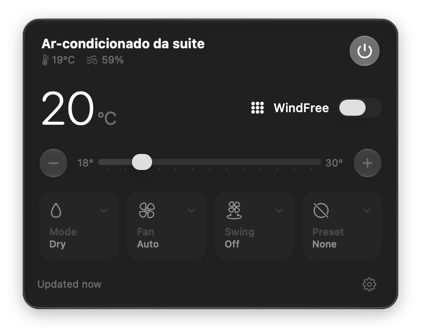

<p align="center"></p>

<h1 align="center">WindFree Bar</h1>

<p align="center"><b>English</b> · <a href="README.pt-BR.md">Português (Brasil)</a></p>

A native macOS menu bar app for controlling a Samsung air conditioner through SmartThings,
built for WindFree units. One click from the menu bar instead of digging through the SmartThings
app: power, temperature, mode, fan, swing, presets and WindFree, with live room readings.

Built in SwiftUI for macOS 26 with standard controls, so it gets Liquid Glass, keyboard control
and VoiceOver from the system. Available in English and Brazilian Portuguese; it follows your
Mac's language.

<p align="center"></p>

## Features

- **Menu bar label** shows the setpoint while the unit is on.
- **Power**, **setpoint** (the system slider with a tick per degree, plus −/+ buttons that repeat
  while held), **mode**, **fan speed**, **swing** and **presets** (sleep, quiet, fast).
- **WindFree** switch: cools through the panel's micro-holes with the blade closed.
- **Room temperature**, **humidity** and **live power draw** in the header.
- **Display light**, **auto clean** and **filter status** in the settings menu.
- **Responsive**: changes apply instantly in the UI and are confirmed against the unit; a poll
  that still reports the old value won't flick the control back.
- **Light on battery and API quota**: polls every 15 s while the panel is open, every 2 min in
  the background (5 min when the unit is off), twice as long in Low Power Mode, and not at all
  while the Mac sleeps or is locked. It backs off when SmartThings rate-limits it.
- **Stays signed in**: OAuth with refresh tokens, so it doesn't die after 24 hours like personal
  access tokens do.
- Keyboard: ⌘↩ power, ⌘R refresh, ⌘Q quit. Open at Login in the settings menu.

## Requirements

- macOS 26 or later on Apple silicon.
- Xcode or just the Command Line Tools (`xcode-select --install`). The build doesn't need Xcode.
- A Samsung air conditioner in your SmartThings account. Tested with a WindFree AI
  (AR60F18D1AWNAZ); other Samsung room ACs that expose `airConditionerMode` should work, and
  controls the unit doesn't support are hidden or disabled.

## Setup

SmartThings personal access tokens now expire after 24 hours, so the app signs in with your own
private OAuth app instead. You create it once with the SmartThings CLI.

1. Install the CLI and sign in when it opens your browser:

   ```sh
   npm install -g @smartthings/cli
   smartthings devices
   ```

2. Create the OAuth app from the template. Edit `appName` in `scripts/smartthings-app.json` first:
   it has to be unique across SmartThings.

   ```sh
   smartthings apps:create -i scripts/smartthings-app.json
   ```

   Note the **OAuth Client Id** and **OAuth Client Secret** it prints. The redirect URI is
   `windfreebar://oauth` and the scopes are `r:devices:*`, `x:devices:*` and `r:locations:*`.

3. Install the app, either way:

   - **Download** `WindFreeBar-x.y.z.dmg` from
     [Releases](https://github.com/pedroseibel/windfree-bar/releases/latest), open it and drag
     **WindFree Bar** onto **Applications**. The app is ad-hoc signed, not notarized, so the
     first launch is blocked: open **System Settings → Privacy & Security** and click
     **Open Anyway** next to WindFree Bar.
   - **Build from source**:

     ```sh
     scripts/build-app.sh --install
     ```

     This builds `WindFree Bar.app`, copies it to `~/Applications`, registers the
     `windfreebar://` URL scheme and launches it.

4. Click the air conditioner in the menu bar, paste the client ID and secret, then click
   **Sign in with SmartThings**. Your browser opens SmartThings' consent page; pick the location
   with your AC and allow it. The browser hands the sign-in back to the app.

## How it works

| Path | What |
| --- | --- |
| `Sources/WindFreeBar/SmartThings/OAuth.swift` | Authorization-code flow in the default browser, token refresh |
| `Sources/WindFreeBar/SmartThings/SmartThingsAPI.swift` | REST client: devices, status, health, commands |
| `Sources/WindFreeBar/SmartThings/CredentialStore.swift` | Client credentials, tokens and preferences on disk |
| `Sources/WindFreeBar/Model/ACState.swift` | The device status, parsed into what the UI needs |
| `Sources/WindFreeBar/Model/ACStore.swift` | Polling policy, optimistic edits, the command queue |
| `Sources/WindFreeBar/Views/` | The menu bar panel |
| `Localization/` | English and Brazilian Portuguese strings |

Each command updates the UI immediately and is kept as a pending edit until the unit reports
the new value (or 12 s pass), so slow-to-report units don't make controls jump back. Commands go
out one at a time, in order, and the status is re-read 2 s and 6 s later.

SmartThings allows 12 status reads and 12 commands per device per minute. SmartThings also
announced API usage limits and a paid plan from October 2026; if requests start failing with
402/403, that's the likely cause.

## Privacy and security

- The OAuth client and tokens are stored in `~/Library/Application Support/WindFreeBar/` as files
  readable only by your user (0600). They're plain files rather than Keychain items because the
  app is ad-hoc signed, and Keychain would ask for permission again after every rebuild.
- Refresh tokens are single-use; every refresh is saved immediately and only one refresh is ever
  in flight.
- The app only talks to `api.smartthings.com`. No analytics, no third parties.
- Sign Out (in the settings menu) deletes the tokens.

## App icon

`scripts/make-icon.swift` draws the icon in the macOS 26 style (a gradient tile with a few large
glass shapes: the unit in front, the cool-mode snowflake behind it) and builds the `.icns`;
`scripts/build-app.sh` runs it on the first build. A live, layered Liquid Glass icon would need
Xcode's `actool`, so this is a flattened rendering of the same treatment.

## Development

```sh
VERSION=1.0.0 scripts/package-release.sh          # disk image for a release (uses dmgbuild)
swift build
.build/out/Products/Debug/WindFreeBar --window    # the panel in a normal window
open -n "build/WindFree Bar.app" --args -AppleLanguages '(en)'   # try a specific language
```

Strings live in `Localization/<language>.lproj/Localizable.strings`. English is the development
language, so its keys are the English text; add a language by adding a `.lproj` folder and listing
it in `CFBundleLocalizations` in `scripts/build-app.sh`.

`@State` is written `@ViewState` (a typealias to `SwiftUI.State` in `Views/ViewState.swift`):
the SDK spells `@State` as a macro whose plugin ships only with Xcode, so the alias keeps the
project buildable with the Command Line Tools alone.

## Disclaimer

Not affiliated with or endorsed by Samsung. Samsung, WindFree and SmartThings are trademarks of
Samsung Electronics.

## License

[MIT](LICENSE)
